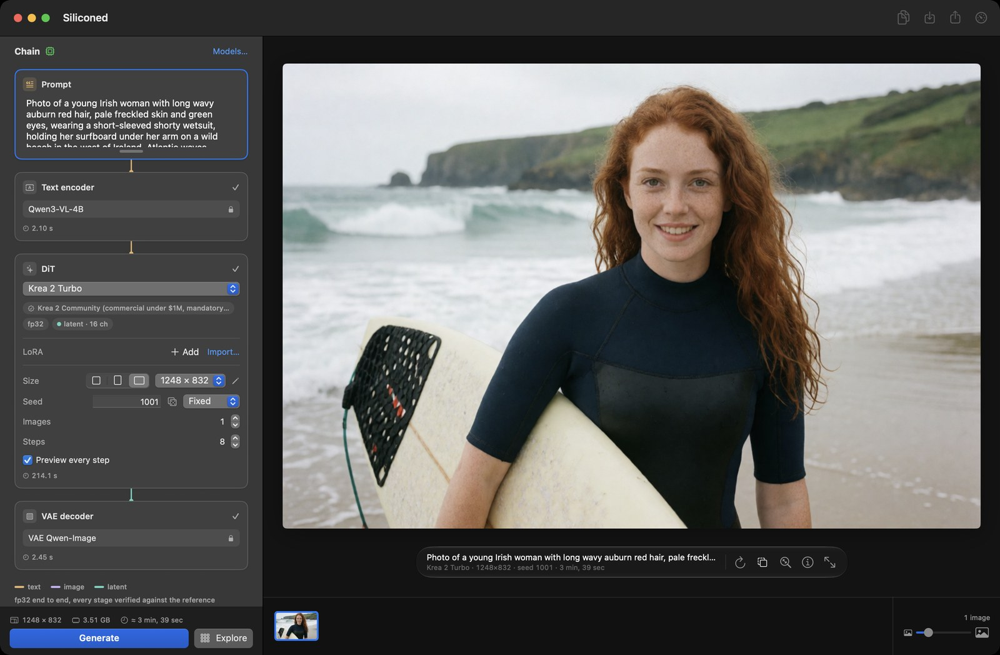

[English](README.md) · Français

# Siliconed

*Siliconed — enhanced by silicone.*

**La génération d'images pour Apple silicon qui fait tout le calcul, le prouve, et ne prend jamais
plus de mémoire que son budget.**

Siliconed est une app macOS libre et gratuite pour la **génération d'images à partir de texte et
l'édition d'images par IA, en local**, sur les Mac Apple silicon (M1 et suivants). Elle fait tourner
des modèles de diffusion récents —
[Z-Image Turbo](https://huggingface.co/Tongyi-MAI/Z-Image-Turbo) et
[Qwen-Image-2.1 Turbo](https://huggingface.co/Qwen/Qwen-Image-2.1-Turbo) — en natif, en Swift et Metal : ni
Python, ni serveur, ni cloud, rien ne quitte votre Mac. Elle marche hors ligne une fois le modèle
installé.


*Une photo de Z-Image Turbo, éditée par Qwen-Image-2.1 avec une phrase (« Convert this photo to a western
comic book style with cel shading »), comparées sous le rideau, filmé à vitesse réelle dans l’app.*

## Pourquoi Siliconed

- **Vérifié contre les modèles d'origine.** Chaque étage (encodeur de texte, débruitage, VAE) est
  comparé, canal par canal, à l'implémentation de référence (diffusers / transformers en fp32 sur
  CPU). Écart à 1024² : 1,2·10⁻⁵ pour Z-Image. Ce qui ne se vérifie pas contre la référence n'est
  pas livré.
- **Tout en fp32, et rapide quand même.** Z-Image Turbo à 1024² en 82 à 85 s sur un M1 Pro
  ([mesuré à côté de Draw Things](#à-côté-de-draw-things), la référence sur Mac).
- **31 Go de modèle sur un Mac de 16 Go, dans un budget fixe.** Les poids sont lus depuis le disque
  au moment où ils servent. Siliconed ne prend jamais plus que les ¾ de la mémoire du Mac moins 2 Go
  (10 Go sur un Mac de 16 Go) : chaque rendu calcule ce qu'il lui faut avant de commencer, prend le
  plan le plus rapide qui y tient, et compare son propre pic à ce chiffre. Ce que les autres
  applications occupent leur appartient.
- **Fait pour être piloté par une IA.** `silicontrol` pilote l'app ouverte depuis un terminal, en
  sortie JSON ; `silicontrol help` est tout ce qu'un agent a besoin de lire.
- **Vos modèles, à votre façon.** Importez LoRA et fine-tunes depuis Civitai ou Hugging Face,
  installez en pleine taille, en 8 bits ou en 4 à 6 bits, et voyez chaque licence et la place disque
  avant le premier octet téléchargé.
- **Explorer avant de choisir.** Une grille d'esquisses rapides à travers graines, pas, forces de
  LoRA, modèles ou variantes du prompt ; la case choisie devient l'image finie.
- **Reproductible au bit près.** Même prompt, même graine, mêmes réglages : la même image, octet
  pour octet. L'édition ci-dessus, refaite dans une autre session, est sortie identique.

## Les modèles

Seulement des modèles récents dont l'encodeur de texte est un modèle de langage — ni Stable
Diffusion, ni SDXL, ni Flux.1.

| Modèle | Éditeur | Ce qu'il fait | Licence |
|---|---|---|---|
| [Z-Image Turbo](https://huggingface.co/Tongyi-MAI/Z-Image-Turbo) | Tongyi-MAI | texte vers image, image vers image, LoRA | Apache 2.0 |
| [Qwen-Image-2.1 Turbo](https://huggingface.co/Qwen/Qwen-Image-2.1-Turbo) | Qwen | texte vers image, édition par instruction avec 1 à 3 images, LoRA | Qwen Research (non commerciale) |

Les versions Compact utilisent des poids 8 bits publiés par des tiers :
[unsloth/Z-Image-Turbo-GGUF](https://huggingface.co/unsloth/Z-Image-Turbo-GGUF),
[Disty0/Z-Image-Turbo-SDNQ-int8](https://huggingface.co/Disty0/Z-Image-Turbo-SDNQ-int8),
[unsloth/Qwen-Image-2.1-FP8](https://huggingface.co/unsloth/Qwen-Image-2.1-FP8),
[Comfy-Org/Qwen-Image-2.1](https://huggingface.co/Comfy-Org/Qwen-Image-2.1) ; les versions Légères, le
GGUF Q4_K_M de [unsloth/Z-Image-Turbo-GGUF](https://huggingface.co/unsloth/Z-Image-Turbo-GGUF) et
d'[unsloth/Qwen-Image-2.1-Turbo-GGUF](https://huggingface.co/unsloth/Qwen-Image-2.1-Turbo-GGUF) avec l'encodeur de
texte de la Compact. Chaque fichier est figé à
une révision et vérifié par sha256 (`Sources/Siliconed/Forge/Installation.swift`).

## L'app

`Siliconed.app` génère des images à partir d'un prompt, les édite par instruction, et tient une file
et un historique. Elle suit la langue du système (anglais, français, allemand, espagnol ou italien).

### Créer

- **Deux modèles.** Z-Image Turbo (Apache 2.0) et Qwen-Image-2.1 Turbo (licence Qwen Research, non
  commerciale). Tous deux lisent le prompt avec un modèle de langage.
- **La chaîne, visible.** Le rack montre le pipeline de haut en bas (prompt, encodeurs, débruitage,
  décodeur), avec des fils typés et l'étage actif allumé ; chaque étage porte ses propres réglages.
- **Plus de détail** : « Détail : Normal · Plus · Maximum » ajoute de la texture fine, sans temps en plus.
- **Les variations** : des cousines d'une image, subtiles ou marquées, aux mêmes réglages.
- **Les LoRA**, et **l'image vers image** avec Z-Image.



### Éditer

- **L'édition par instruction** avec Qwen-Image-2.1 : donnez-lui 1 à 3 images et une phrase
  (« remplace le ciel nuageux par un ciel bleu ») ; son encodeur voit les images. Dans l'app, une
  édition est plafonnée à une surface de 1024².
- **Le rideau** : faites glisser une ligne sur deux images, ou sur une édition et son original, pour
  voir ce qui a changé.
- **Un historique comme dans Photos** : flèches, ⌫ et ⌘Z, sélection multiple, comparaison côte à
  côte, export, glisser-déposer, Partager.


### Explorer

Le panneau d'exploration construit une grille dans le canevas. Ses axes : les graines, les pas, la
force d'une LoRA, des LoRA à essayer, les modèles, les variantes écrites entre accolades dans le
prompt, ou chaque image d'une édition. Chaque case est une esquisse, arrêtée après quelques pas, à
512 sur le petit côté (avec Qwen-Image-2.1, une image finie) ; dès qu'un modèle a rendu à cette
taille, le panneau dit ce que la grille coûtera sur ce Mac avant de la lancer. « Finir cette image »
rend la case choisie jusqu'au bout avec la même graine : l'image que son esquisse annonçait.


### La gestion des modèles

- **Rien n'est préinstallé.** Vous choisissez un modèle ; avant le premier octet téléchargé, l'app
  affiche sa licence et la place qu'il prend sur disque, et vous demande d'accepter. Chaque fichier
  est figé à une révision et vérifié par sha256.
- **Standard, Compact ou Légère.** Z-Image et Qwen-Image-2.1 s'installent avec les poids de
  l'éditeur (Standard, le défaut), avec des poids 8 bits publiés par des tiers pour le transformer et
  l'encodeur de texte (Compact : 11,7 Go au lieu de 20,4 pour Z-Image, 17,3 Go au lieu de 31,2 pour
  Qwen-Image-2.1, une image légèrement différente, à peu près aussi rapide), ou avec le transformer
  en 4 à 6 bits tel qu'un tiers le publie (GGUF Q4_K_M) et l'encodeur de texte de la Compact
  (Légère : 9,5 Go et 14,2 Go, le moins lu sur le disque à chaque pas ; un autre jeu de poids, une
  image qui peut se composer autrement). La Légère est présélectionnée sur un Mac de 8 Go de
  mémoire, la Standard ailleurs ; vous choisissez avant d'installer. Une version à la
  fois : passer à l'autre la remplace ; l'installée continue de rendre jusqu'à ce que la nouvelle
  soit complète, puis libère sa place — si le disque ne peut pas tenir les deux, l'app le dit avant
  l'acceptation (`docs/API.fr.md` §3.11).
- **Les imports Civitai et Hugging Face.** Les LoRA (formats Civitai, Comfy, kohya, diffusers) et le
  DiT d'un fine-tune (`.safetensors`, ou `.gguf` de Q4 à Q8_0), par glisser-déposer. Un fichier
  quantifié reste sur le disque tel que publié, jamais requantifié (Z-Image : 6,2 Go en 8 bits, environ
  5 Go en GGUF Q4_K_M, au lieu de 12,3 Go ; chaque pas un peu plus lent, le calcul reste en fp32) ;
  sous 4 bits, le fichier est refusé (`docs/API.fr.md` §3.11).
- **Statistiques et diagnostic.** La palette des statistiques (⌥⌘I) et « Signaler ma configuration »
  (un diagnostic mesuré, exporté en JSON) sont des boutons de la barre d'outils.

Les modèles vivent dans `~/Library/Application Support/Siliconed` (modifiable avec `SILICONED_ROOT`).


### Privé par construction

Le rendu se fait sur votre Mac. Le seul trafic réseau est le téléchargement du modèle que vous avez
accepté ; le diagnostic ouvre une issue GitHub préremplie que vous choisissez de soumettre ou non.
Avant chaque rendu, le moteur vérifie le modèle, sa licence, le format et la mémoire qu'il lui faut,
et refuse d'emblée un rendu au-delà du budget de ce Mac.

## Télécharger

L'app est distribuée en `.dmg` sur la page
[Releases](https://github.com/gwenn-ha-dev/Siliconed/releases). Prérequis : macOS 15 ou plus, Apple
silicon. Les temps ci-dessous ont été mesurés avec 16 Go de mémoire.

## Les chiffres

Machine de référence : MacBook Pro M1 Pro (8 cœurs, 14 cœurs GPU), 16 Go. 1024², graine 42.

| | Z-Image Turbo | Qwen-Image-2.1 Turbo |
|---|---|---|
| 1024², Standard | 82–85 s (8 pas ; 1024×1536 ~153 s) | 118 s (8 pas) ; 1024×1536 190 s ; une édition à 1 image 212 s, à 2 images 285 s |
| 1024², Légère (4 à 6 bits) | 83–89 s | 123–130 s ; une édition à 1 image 210 s |
| pic mémoire, Standard / Légère | 2,7 Go / 2,0 Go | 1,8–2,7 Go / 1,5 Go |
| écart à la référence fp32 (`model_out`) | 1,2·10⁻⁵ | 3,0·10⁻⁶ de l'exact fp64 (512²) |

Chaque temps est celui d'un rendu mis en file dans l'app par `silicontrol`, de la file au PNG,
mesuré le 13/10/2026. Le pic mémoire est le `phys_footprint` de l'app, relevé toutes les 100 ms ;
0 page swappée sur les 27 rendus. Comment l'écart est mesuré : [La vérification](#la-vérification).

### À côté de Draw Things

[Draw Things](https://drawthings.ai) est la référence sur Mac ; ici, son moteur communautaire,
[draw-things-community](https://github.com/drawthingsai/draw-things-community) à `bc3970c`, avec
les réglages par défaut du modèle (UniPC trailing, CFG 1). La même machine, la même séance de 70 minutes, un seul moteur chargé à la
fois ; Z-Image Turbo, 1024², 8 pas, graine 42, trois rendus de chaque côté sur trois variantes du
même prompt, puis un de plus après l'autre côté.

| | poids | temps | pic mémoire | lu sur le disque par rendu |
|---|---|---|---|---|
| Siliconed, Standard | les bf16 de l'éditeur, calculés en fp32 | 82–85 s | 2,7 Go | 52 Go |
| Siliconed, Légère | GGUF Q4_K_M | 83–89 s | 2,0 Go | 3,5–9 Go |
| Draw Things, Exact | f16 | 167–179 s | 5,3 Go | 99 Go |
| Draw Things, par défaut | 8 bits (`q8p`) | 142–164 s | 3,5–4,3 Go | 11 Go |
| Draw Things, 6 bits | 6 bits (`q6p`) | 136–138 s | 3,5 Go | 6–14 Go |

La comparaison porte sur le temps écoulé, pas sur une arithmétique identique : les solveurs et les
poids diffèrent, les images aussi. Le pic mémoire ne compte pas les poids projetés depuis le disque,
d'un côté comme de l'autre. Siliconed fait chauffer davantage la machine, ce qui découle du calcul
en fp32.

**Dans le budget, mesuré.** Le pic `phys_footprint` de chaque modèle et ses pages swappées (delta
`vm_stat`) sont mesurés au pire cas du produit, sur un Mac de 16 Go où rien d'autre ne tourne : Qwen-Image-2.1 à 1024×1536 avec 3 références,
0 page swappée ; Z-Image à 1024×1536, pic 3,8 Go, 0 page swappée (son VAE décode en bandes, aux
mêmes bits).

Chaque côté doit être d'au moins 512 et multiple de 16, pour une surface d'au plus 1024×1536. Sous
512² les modèles sont hors de leur domaine.

## Face aux autres outils

- **[Draw Things](https://drawthings.ai)**, l'app native de référence sur Mac : son moteur est
  [mesuré plus haut](#à-côté-de-draw-things) sur la même machine. Siliconed calcule en fp32 et il est
  vérifié étage par étage contre l'implémentation de référence.
- **[ComfyUI](https://github.com/comfyanonymous/ComfyUI) ou [diffusers](https://github.com/huggingface/diffusers)
  en Python** : les mêmes modèles, sans environnement Python ni graphe de nœuds à câbler. Siliconed
  les implémente en natif et se vérifie contre diffusers et
  [transformers](https://github.com/huggingface/transformers) ; `silicontrol` couvre les scripts et
  l'automatisation.

## Le diagnostic communautaire

Une machine ne fait pas un banc. Le bouton **Signaler ma configuration** de l'app (*Report My
Configuration* en anglais) lance un court diagnostic (environ 15 s par modèle installé, à 512² :
l'encodeur, deux évaluations du débruitage, le décodeur), vérifie la sortie du débruitage canal par
canal contre une petite référence embarquée dans l'app, et ouvre une issue GitHub préremplie avec le
rapport JSON : puce, cœurs CPU et GPU, mémoire, macOS, temps par étage, rendu entier estimé, pic
mémoire, swap, octets lus sur le disque, plan mémoire suivi, état thermique et alimentation avant et
après, réglages qui diffèrent des défauts, et une courte multiplication de matrices chronométrée sur
le GPU et sur le CPU. Rien n'est envoyé tant que vous ne soumettez pas l'issue.

Les rapports remplissent ce tableau, une ligne par puce :

| Puce | Cœurs CPU | Cœurs GPU | Mémoire | Z-Image Turbo 1024² | Qwen-Image-2.1 Turbo 1024² | Source |
|---|---|---|---|---|---|---|
| M1 Pro | 8 | 14 | 16 Go | 82–85 s | 118 s | machine de référence |
| *votre ligne ici* | | | | | | [rapport](https://github.com/gwenn-ha-dev/Siliconed/issues/new?template=diagnostic.yml) |

## Pour les agents IA et les scripts : silicontrol

Pilote l'app ouverte depuis un terminal. Elle est livrée dans
`Siliconed.app/Contents/Helpers/silicontrol` ; le menu de l'app la lie dans `/usr/local/bin`. Ce que
vous ajoutez apparaît dans la fenêtre de l'app, et il n'y a qu'une file, jamais deux rendus à la
fois.

```
silicontrol help                 la référence complète (toujours commencer par là)
silicontrol models
silicontrol add --wait --out out "a woman posing in a library"
silicontrol status
```

La sortie est en lignes JSON ; la dernière porte `"ok"`. Le dedans : `docs/REMOTE-CONTROL.fr.md`.

## Pour les développeurs

**La bibliothèque `Siliconed`.** Une API Swift pour écrire votre propre app sur le moteur :
`docs/API.fr.md`. L'app en est l'exemple de référence, compilée avec le paquet.

### Construire depuis les sources

macOS 15 ou plus, Apple silicon, Xcode 26 ou plus (l’app emploie les API de macOS 26 là où le système les a).

```
swift build                 la bibliothèque, l'app et silicontrol
swift test                  les tests unitaires purs, sans aucun poids
tools/app.sh                construit Siliconed.app à la racine du dépôt et l'ouvre
tools/app.sh --no-open      construit seulement
tools/dmg.sh                emballe l'app construite en .build/Siliconed-<version>.dmg
```

`swift test` ne demande rien d'autre : ni poids, ni Python.

Par défaut, l'app est signée ad hoc : elle tourne sur le Mac qui l'a construite. Pour la distribuer,
signez-la avec votre Developer ID :

```
tools/app.sh --sign "Developer ID Application: <nom> (<équipe>)"
```

Si `SILICONED_NOTARY_PROFILE` nomme un profil de trousseau `notarytool`, l'app est aussi notariée et
agrafée ; `tools/dmg.sh` signe et notarie alors l'image disque avec la même identité.

### La vérification

Chaque étage (encodeur de texte, débruitage, VAE) est comparé à l'implémentation de référence,
diffusers et transformers en fp32 sur CPU, sur la même entrée. L'écart se mesure canal par canal,
chaque canal rapporté à sa propre norme, pour qu'une faute confinée à un canal ne se cache pas dans
un chiffre global. Quand la référence fp32 porte sa propre erreur d'arrondi, l'une et l'autre sont
jugées contre un calcul fp64 du même étage, et le moteur ne doit pas s'en écarter de plus que la
référence plus 25 %. Le pic mémoire se lit sur `phys_footprint`, échantillonné pendant le rendu, le
swap sur `vm_stat`, et chaque chrono est encadré par une mesure témoin avant et après, car la machine
dérive de plusieurs pour cent d'un rendu à l'autre. Le banc d'oracles et le journal des mesures ne
font pas partie de ce dépôt ; ce qui est livré, ce sont les tests unitaires purs et la petite
référence contre laquelle le diagnostic vérifie.

## Documentation

- `docs/API.fr.md` : l'API de la bibliothèque `Siliconed`, pour écrire une app par-dessus.
- `docs/REMOTE-CONTROL.fr.md` : `silicontrol`, protocole et fonctionnement interne.
- `RELEASE-NOTES.fr.md` : ce qui change à chaque version.
- Les issues : [rapport de diagnostic, bug, idée](https://github.com/gwenn-ha-dev/Siliconed/issues/new/choose)
  (en anglais).

## Crédits

Les modèles appartiennent à leurs éditeurs (tableau ci-dessus), chacun sous sa propre licence. Les
implémentations de référence sont [diffusers](https://github.com/huggingface/diffusers) et
[transformers](https://github.com/huggingface/transformers), de Hugging Face ; le rééchantillonnage
des images reproduit le Lanczos de [Pillow](https://github.com/python-pillow/Pillow) au bit près. Les
LoRA et les fine-tunes viennent de la communauté, sur [Civitai](https://civitai.com) et
[Hugging Face](https://huggingface.co).

## Licence

Le code est sous [licence Apache 2.0](LICENSE). Les poids des modèles ne font pas partie de ce
dépôt : chacun est téléchargé par vous, sous sa propre licence, que l'app affiche avant de
l'installer.
