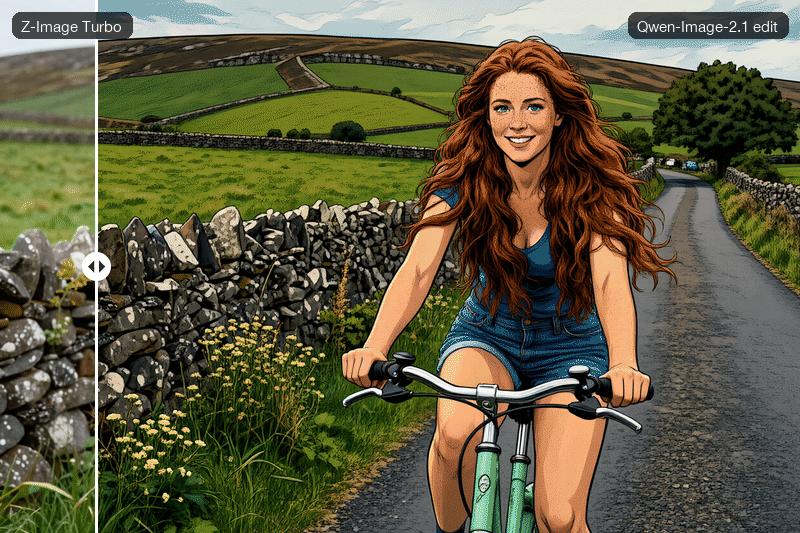
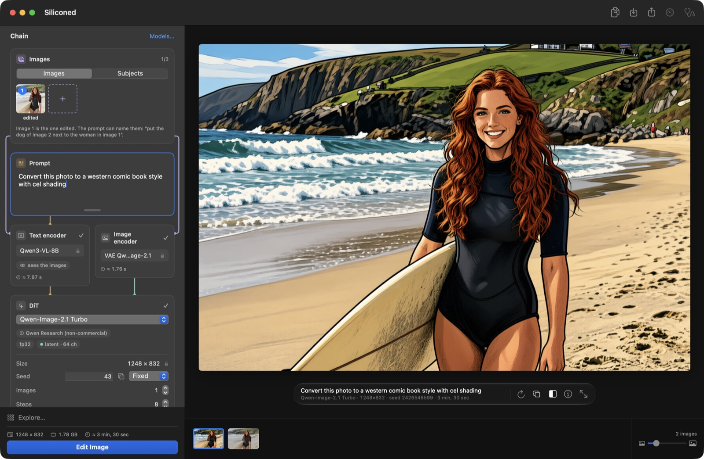
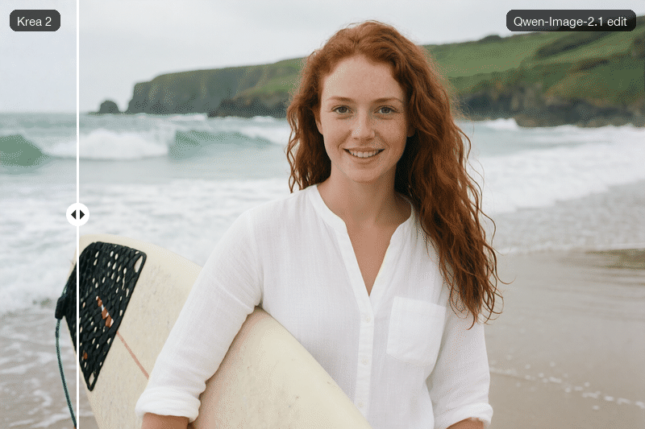
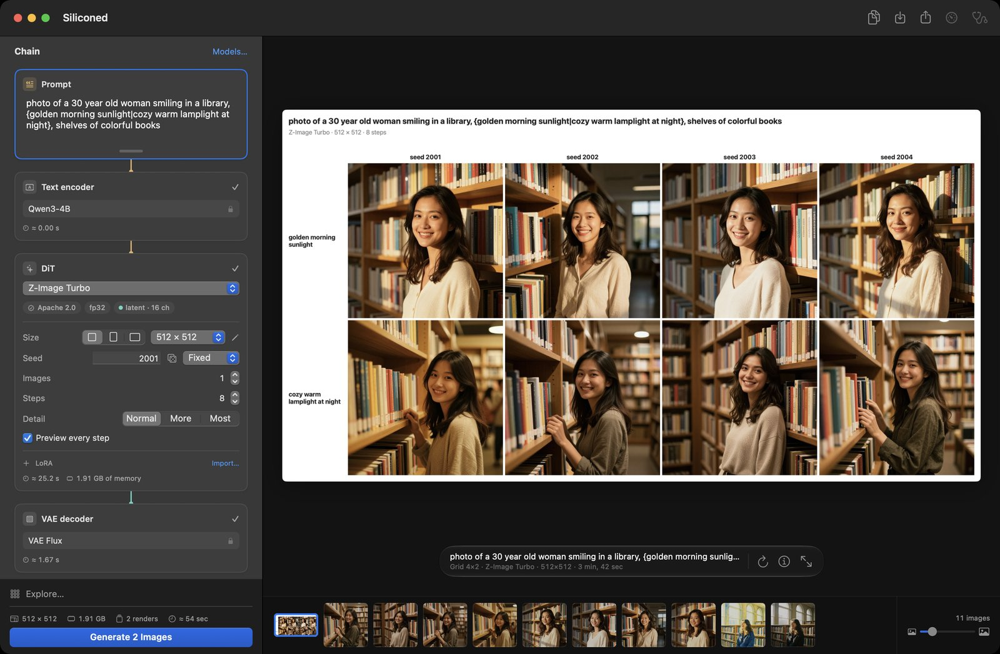
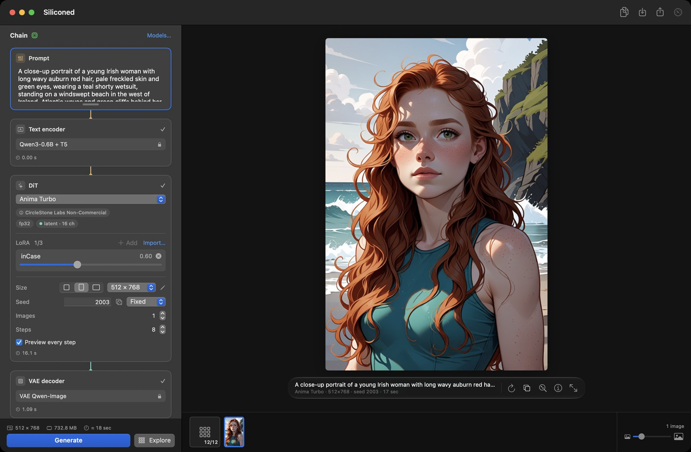
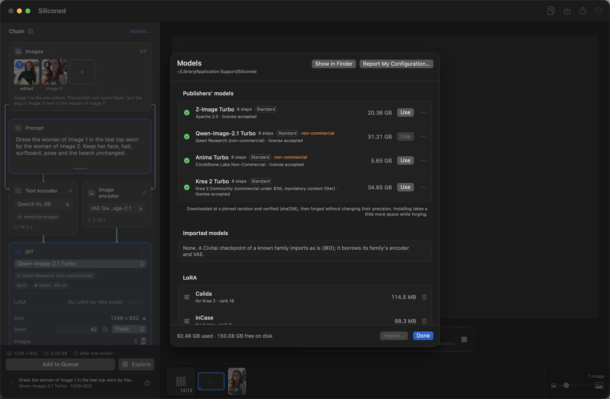

English · [Français](README.fr.md)

# Siliconed

*Siliconed — enhanced by silicone.*

**Image generation for Apple silicon that does the full computation, proves it, fits itself to your
Mac, and never takes more memory than its budget.**

Siliconed is a free, open-source macOS app for **local text-to-image generation and AI image
editing** on Apple silicon Macs (M1 and later). It runs recent diffusion models —
[Krea 2 Turbo](https://huggingface.co/krea/Krea-2-Turbo),
[Z-Image Turbo](https://huggingface.co/Tongyi-MAI/Z-Image-Turbo),
[Qwen-Image-2.1 Turbo](https://huggingface.co/Qwen/Qwen-Image-2.1-Turbo) and
[Anima Turbo](https://huggingface.co/circlestone-labs/Anima) — natively in Swift and Metal: no
Python, no server, no cloud, nothing leaves your Mac. It works offline once a model is installed.




*A photo from Krea 2 Turbo, edited by Qwen-Image-2.1 with one sentence (“Convert this photo to a western
comic book style with cel shading”), compared under the curtain.*

## Krea 2 Turbo, new in 0.12

[Krea 2 Turbo](https://huggingface.co/krea/Krea-2-Turbo), by Krea, is the fourth model: a
12.9-billion-parameter DiT, the largest of the four, for aesthetic images from photography to
painting. It reads the prompt with Qwen3-VL-4B and runs its whole 8-evaluation recipe in fp32 on the
publisher's bf16 weights: **1024² in 145.6 s, 1024×1536 in 216.9 s on a 16 GB M1 Pro** with
[Faster Rendering](#faster-rendering), on by default (221.1 s and 355.3 s with every evaluation at
full size), its 34.4 GB streamed from disk within the memory budget. Its denoiser's output is 1.44·10⁻⁴ from the fp32
reference at 1024². It installs as Standard, Compact or Light (34.4, 19.5 or 12.8 GB), from open
copies proven identical to Krea's files ([why](#models)), under the Krea 2 Community license:
commercial use under $1M of annual revenue, a content filter required when deployed.


*Krea 2 Turbo, Standard, 1248×832, 8 steps, on an M1 Pro: “Photo of a young Irish woman with long wavy auburn red hair, pale freckled skin and green eyes, wearing a short-sleeved shorty wetsuit, holding her surfboard under her arm on a wild beach in the west of Ireland. Atlantic waves breaking behind her, green cliffs, overcast soft light. Natural skin texture, candid smile, 35 mm photograph.”, seed 1001, 226 s.*

## An engine measured on your Mac

Before its very first render, Siliconed measures the Mac it runs on — about a minute, no model needed. It times the real matrix products of the models' DiT blocks on the GPU, on the CPU's matrix unit (AMX), on the Neural Engine and on the GPU beside each, attention through three kernels, products read straight from published int8 and Q8_0 weights, and bf16 products on the GPU's tensor units, and checks every output against the exact result. That report becomes **this Mac's map**, measured again whenever the Mac, macOS or the app changes, and the map picks the kernels: one turns on only if it computed right and beats the default by at least 5 % (more if the machine drifted during the measure). On the M1 Pro of the numbers below, on 23/10/2026: GPU + AMX co-execution on (×1.26), the Neural Engine beside the GPU on (×1.42), attention split by heads between the GPU and the CPU on (×1.48), flash attention off (×1.03, inside the margin), Q8_0 products off (×0.37), bf16 tensor products off (×0.47). The AMX and the Neural Engine share the products shape by shape: the Neural Engine takes a shape wherever it keeps 90 % of the AMX's speed there, for the energy it saves. Another chip measures its own and decides otherwise. The map buys speed, never another picture beyond the arithmetic it checked — the Neural Engine's fp16 is yours to choose ([how](#the-neural-engine)); Help → **Measure This Mac** shows the map and lets you share it ([Community diagnostic](#community-diagnostic)).

## Why Siliconed

- **Checked against the original models.** Every stage (text encoder, denoiser, VAE) is compared,
  channel by channel, with the reference implementation (diffusers / transformers in fp32 on CPU),
  and since 0.12 rounds where the reference rounds. What cannot be checked against the reference
  does not ship.
- **Full fp32, still fast.** Z-Image Turbo at 1024² in 84.5 s on an M1 Pro with the 8
  evaluations its recipe calls for, the first three on a half-size grid
  ([Faster Rendering](#faster-rendering), on by default); 117.7 s with all of them at full size
  ([next to Draw Things](#next-to-draw-things), the reference on the Mac). Or, on request, part of
  the denoiser on the Neural Engine, for about a fifth less energy ([how](#the-neural-engine)).
- **34 GB of model on a 16 GB Mac, within a fixed budget.** Weights are read from disk as they are
  needed. Siliconed never takes more than ¾ of the Mac's memory minus 2 GB (10 GB on a 16 GB Mac):
  each render computes what it needs before it starts, takes the fastest plan that fits, and checks
  its own peak against that figure. What the other applications hold is theirs.
- **Built to be driven by an AI.** `silicontrol` drives the running app from a terminal, with JSON
  output; `silicontrol help` is all an agent needs to read.
- **Your models, your way.** Import LoRAs and fine-tunes from Civitai or Hugging Face, install
  full-size, in 8 bits or in 4 to 6 bits, and see each license and the disk space before the first
  byte is downloaded.
- **Explore before you commit.** A grid of quick sketches across seeds, steps, LoRA strengths,
  models or prompt variants; the cell you pick becomes the finished image.
- **Reproducible to the bit.** Same prompt, seed, settings and version on the same Mac, same image,
  byte for byte. A version may change the pixels: 0.12 does, by a few units in the last place, now
  that its arithmetic rounds as the reference does.

## The app

`Siliconed.app` generates images from a prompt, edits them by instruction, and keeps a queue and a
history. It follows the system language (English, French, German, Spanish or Italian).


### Create

- **Four models.** Krea 2 Turbo, Z-Image Turbo, Qwen-Image-2.1 Turbo and Anima Turbo, each under its
  own license ([Models](#models)). All four read the prompt with a language model.
- **The chain, visible.** The rack shows the pipeline top to bottom (prompt, encoders, denoiser,
  decoder), with typed wires and the active stage lit; each stage holds its own settings.
- **More detail** with Z-Image and Qwen-Image-2.1: « Detail: Normal · More · Most » adds fine
  texture, at no extra time.
- **Faster Rendering** (Settings, on by default): from 1024 px on each side, the first
  evaluations on a half-size grid, the rest at full size: a quarter to two fifths faster, still 8
  evaluations, a slightly different image ([how](#faster-rendering)).
- **Variations**: cousins of an image, subtle or strong, with the same settings.
- **Enlarge ×4** with macOS's own super-resolution (macOS 26): no prompt, nothing added, edges and
  texture sharpened; 1024² becomes 4096² in a second or two.
- **LoRAs** on all four models.

### Edit

- **Editing by instruction** with Qwen-Image-2.1: give it 1 to 3 images and a sentence (“replace the
  cloudy sky with a blue sky”); its encoder sees the images. In the app an edit is capped at a
  surface of 1024².
- **Curtain**: drag a line across two images, or across an edit or an enlargement and its
  original, to see what changed; zoom in toward the pointer to look at a detail.
- **A history like Photos**: arrows, ⌫ and ⌘Z, multiple selection, side-by-side comparison, export,
  drag and drop, Share.



*Qwen-Image-2.1 Turbo, Standard: “Convert this photo to a western comic book style with cel shading”, the Krea 2 photo as image 1, seed 42, 206 s.*



*An edit that changes only what it is told: “Replace her wetsuit with a white linen blouse. Keep her face, hair, surfboard, pose and the beach unchanged.”, the Krea 2 photo as image 1, seed 42, 211 s.*

### Explore

The exploration panel builds a grid in the canvas. Its axes: seeds, steps, the strength of a LoRA,
LoRAs to try, models, the alternatives written in braces in the prompt, each image of an edit, or,
in Developer Mode, the solvers. Each cell is a sketch, stopped after a few steps, at 512 on the
short side (with Qwen-Image-2.1, a finished image); once a model has rendered at that size, the
panel shows what the grid will cost on this Mac before you start. « Finish This Image » renders the
chosen cell to the end with the same seed: the image its sketch announced.





*The chosen cell, finished: Anima Turbo with the inCase LoRA, strength 0.6, “A close-up portrait of a young Irish woman with long wavy auburn red hair, pale freckled skin and green eyes, wearing a teal shorty wetsuit, standing on a windswept beach in the west of Ireland. Atlantic waves and green cliffs behind her, soft overcast light, wind in her hair.”, 512×768, seed 2003, 17 s.*

### Model management

- **Nothing is preinstalled.** You pick a model; before the first byte is downloaded the app shows
  its license and the disk space it takes, and asks you to accept. Every file is pinned to a
  revision and checked by sha256.
- **Standard, Compact or Light.** Each model installs with the publisher's weights (Standard, the
  default), with 8-bit weights published by third parties (Compact: 19.5 GB instead of 34.4 for
  Krea 2, 11.7 GB instead of 20.4 for Z-Image, 17.3 GB instead of 31.2 for Qwen-Image-2.1, 4.10 GB
  instead of 5.65 for Anima; an image slightly different), or with the transformer in 4 to 6 bits
  as a third party publishes it (GGUF Q4_K_M; Light: 12.8 GB, 9.5 GB, 14.2 GB and 3.31 GB, the least
  read from disk at each step; another set of weights, an image that may compose differently). For
  Krea 2, Z-Image and Qwen-Image-2.1 the Compact's text encoder is 8-bit too, and the Light uses it;
  Anima's text encoder stays the publisher's bf16 in all three, since no 8-bit version of it is
  published. The Light is preselected on a Mac with 8 GB of memory, the Standard elsewhere; you
  choose before installing. One version at a time: switching replaces the other, which keeps
  rendering until the new one is complete, then frees its space; if the disk cannot hold both, the
  app says so before you accept.
- **Civitai and Hugging Face imports.** LoRAs (Civitai, Comfy, kohya, diffusers layouts) and a
  fine-tune's DiT (`.safetensors`, or `.gguf` from Q4 to Q8_0), by drag and drop or ⌘O; a Civitai
  checkpoint of a known family imports as is and borrows its family's encoder and VAE. Dropped before
  its family is installed, it opens the family's installation — license, encoder and VAE, never the
  family's own DiT — and is imported once that is done. A quantized file stays as published on
  disk, never re-quantized (Z-Image: 6.2 GB in 8 bits, about 5 GB in GGUF Q4_K_M, instead of
  12.3 GB; each step a little slower, the computation stays fp32); below 4 bits, the file is
  refused. An imported LoRA takes its file's name; the trainer's name and trigger words show in a
  tooltip.
- **Statistics and diagnostic.** The statistics palette (⌥⌘I) is a toolbar button. « Measure This Mac » (Help menu, or « Chain » at the head of the rack, orange until this Mac is
  measured) shows this Mac's map: what the chip computes, measured, and the paths the engine takes.

Models live in `~/Library/Application Support/Siliconed` (override with `SILICONED_ROOT`). To free
the internal disk, Settings moves them to another one — an external disk, a network share: every file
is copied, checked, then removed from the Mac. Siliconed then copies to the Mac only the models you
render, for the session, and removes them when it quits; the licenses you accepted and this Mac's
measure stay on the Mac. Unplugged, the disk is flagged: nothing renders until it is back.



### Private by construction

Rendering happens on your Mac. The only network traffic is the model download you accepted; the
diagnostic copies its report and opens a GitHub issue form that you choose to submit or not. The
render cache lasts one session: it is emptied at launch and at quit. Before each render the engine
checks the model, its license, the format and the memory it needs, and refuses up front a render
beyond this Mac's budget. The app censors no prompt and adds no content filter; each model's license
still applies, and Krea 2 Community's asks whoever deploys the model for one.

## Models

Only recent models whose text encoder is a language model — no Stable Diffusion, SDXL or Flux.1.

| Model | Publisher | What it does | License |
|---|---|---|---|
| [Krea 2 Turbo](https://huggingface.co/krea/Krea-2-Turbo) | Krea | text-to-image (aesthetic images, from photography to painting), LoRA | Krea 2 Community: commercial use under $1M annual revenue, a content filter required when deployed |
| [Z-Image Turbo](https://huggingface.co/Tongyi-MAI/Z-Image-Turbo) | Tongyi-MAI | text-to-image, LoRA | Apache 2.0 |
| [Qwen-Image-2.1 Turbo](https://huggingface.co/Qwen/Qwen-Image-2.1-Turbo) | Qwen | text-to-image, editing by instruction with 1 to 3 images, LoRA | Qwen Research (non-commercial) |
| [Anima Turbo v1.1](https://huggingface.co/circlestone-labs/Anima) | CircleStone Labs × Comfy Org | text-to-image (illustration, painting, anime; no photorealism, by its publisher's choice), LoRA | CircleStone Labs Non-Commercial; its images may be used commercially |

Krea 2 Turbo downloads nothing from [krea/Krea-2-Turbo](https://huggingface.co/krea/Krea-2-Turbo):
that repository asks for a Hugging Face account, and the app has no sign-in. Each of its files
comes from an open copy proven identical to Krea's: the DiT and the Qwen3-VL-4B text encoder in bf16
from [Comfy-Org/Krea-2](https://huggingface.co/Comfy-Org/Krea-2) (the DiT the very same file, the
encoder equal tensor for tensor), the VAE from [Qwen/Qwen-Image](https://huggingface.co/Qwen/Qwen-Image)
(Krea's fp32 VAE is this bf16 one widened, value for value), the tokenizer from
[Qwen/Qwen-Image-2.1-Turbo](https://huggingface.co/Qwen/Qwen-Image-2.1-Turbo) (the same file); Krea's
own configuration files are embedded as published. Its Compact takes the DiT and the text encoder in
int8 convrot from [Comfy-Org/Krea-2](https://huggingface.co/Comfy-Org/Krea-2); its Light, the GGUF
Q4_K_M of [vantagewithai/Krea-2-Turbo-GGUF](https://huggingface.co/vantagewithai/Krea-2-Turbo-GGUF)
with the Compact's text encoder.

The other Compact versions use 8-bit weights published by third parties:
[unsloth/Z-Image-Turbo-GGUF](https://huggingface.co/unsloth/Z-Image-Turbo-GGUF),
[Disty0/Z-Image-Turbo-SDNQ-int8](https://huggingface.co/Disty0/Z-Image-Turbo-SDNQ-int8),
[unsloth/Qwen-Image-2.1-FP8](https://huggingface.co/unsloth/Qwen-Image-2.1-FP8),
[Comfy-Org/Qwen-Image-2.1](https://huggingface.co/Comfy-Org/Qwen-Image-2.1); the Light versions, the
GGUF Q4_K_M of [unsloth/Z-Image-Turbo-GGUF](https://huggingface.co/unsloth/Z-Image-Turbo-GGUF) and
[unsloth/Qwen-Image-2.1-Turbo-GGUF](https://huggingface.co/unsloth/Qwen-Image-2.1-Turbo-GGUF) with the Compact's
text encoder. Anima's Compact and Light take the DiT in GGUF Q8_0 and Q4_K_M from
[vanes430/Anima-Turbo-V1.1-GGUF](https://huggingface.co/vanes430/Anima-Turbo-V1.1-GGUF) and keep
the publisher's text encoder in bf16 (no 8-bit version of it is published). Every file is pinned to
a revision and checked by sha256 (`Sources/Siliconed/Forge/Installation.swift`).

## Download

The app ships as a `.dmg` on the [Releases](https://github.com/gwenn-ha-dev/Siliconed/releases) page.
Requirements: macOS 15 or later, Apple silicon. The timings below were measured with 16 GB of memory.

## Numbers

Reference machine: MacBook Pro M1 Pro (8 cores, 14 GPU cores), 16 GB. Seed 42, 8 steps.

| | Krea 2 Turbo | Z-Image Turbo | Qwen-Image-2.1 Turbo | Anima Turbo |
|---|---|---|---|---|
| 1024², Standard, Faster Rendering (default) | **145.6 s** | **84.5 s** | **103.7 s** | **32.7 s** |
| 1024², Standard, every evaluation at full size | 221.1 s | 117.7 s | 142.7 s | 44.4 s |
| 1024×1536, Standard, Faster Rendering / full size | 216.9 s / 355.3 s | 131.0 s / 190 s | 161.7 s / 232 s | 52.5 s / 75.6 s |
| other, Standard | | | an edit with 1 image 211 s, with 2 images 297 s | 512² 12.1 s |
| 1024², Light (4 to 6 bits), Faster Rendering (default) | 153.8 s | 89.7–91.1 s | 111.0 s | 35.4 s |
| peak memory, Standard / Light | 3.07 GB (1024×1536: 3.51 GB), the engine alone / 1.55 GB | 2.8 GB / 2.1 GB | 1.8–2.7 GB / 1.5 GB | 1.4 GB (the engine alone) / 1.4 GB |
| deviation from the fp32 reference (`model_out`, full size) | 1.44·10⁻⁴ (1024²) | 1.2·10⁻⁵ | 3.0·10⁻⁶ from the fp64 exact (512²) | 1.4·10⁻⁵ from the fp64 exact (1024²), the fp32 reference at 1.5·10⁻⁵ |

Each time is a render queued in the app by `silicontrol`, from the queue to the PNG, this Mac's map
in service. With Faster Rendering: 19/10/2026, app 0.12, the setting at its default; a Z-Image 1024²
render with it off, as a witness, took 112.0 s in the same series. Light, and Z-Image's Standard peak:
19/10/2026 in the evening, app 0.12, the setting at its default, each render in a freshly opened app,
0 swap-out; Z-Image's first and last Light renders, as witnesses, took 91.1 and 90.5 s. Every
evaluation at full size, 1024²: 18/10/2026, app 0.12, 0 swap-out; a last Z-Image render at the end of that series, as a
witness, took 123.6 s (the machine drifts by a few percent from one render to the next); Krea 2's
1024×1536: the same series. The other times: Qwen-Image-2.1 on
15/10/2026 with 0.10, Z-Image on 14/10/2026 with 0.8.2. Peak memory is the app's `phys_footprint`,
sampled every 100 ms. Anima Turbo's other times and its peak are those of the engine alone, without
the app, render cache off (14–15/10/2026); Krea 2 Turbo's Standard peaks too (17/10/2026). How the deviation
is measured: [Verification](#verification).

Until 0.8.1, Z-Image Turbo ran 7 of the 8 DiT evaluations its recipe calls for; the times published
then (82–85 s at 1024²) were for 7. Fixed in 0.8.2: 8 full-size evaluations. Faster Rendering is
not that shortcut: it keeps all 8 evaluations.

### Faster Rendering

On by default, at the head of Settings, for all four models. From 1024 px on each side (1024²,
1024×1536, 1536×1024…), the first evaluations run on the half-size grid — 3 of 8 for Z-Image, Qwen-Image-2.1 and Anima, 4 for
Krea 2, whose schedule keeps its first noise levels higher — and the rest at full size. Still 8
evaluations; one at half size costs about a quarter of a full one. No usual portrait or landscape
format qualifies: the half of 832×1216 would fall under 512 px on one side.

The small grid is fed the averaged state plus the low band of the starting noise, so it holds a
clean, correctly noised picture; the velocity brought back to full size is the one that leads the
full state to the enlarged clean estimate, so it also takes away the fine noise a half grid cannot
see, at the pace a full step would. The half-size steps dropped in 0.8.2 had neither: their
enlarged velocity left that fine noise in place (sand on skin and walls), and their small grid was
a plain decimation, whose aliasing the model read as texture (cracks). Each model's number of half-size evaluations was
judged by eye on two prompts, a portrait and the library: no
sand, no cracks, freckles, hair and book spines intact; one step more, and fine detail starts to go.

It makes another image than the full-size recipe with the same seed (the composition is decided in
the first steps: the same scene, sometimes another person), not a degraded copy of it. Not with a
LoRA, Detail, an edit, another number of steps or another schedule. Off, every evaluation is at full
size and the image is the same, to the bit, as before: the one checked against diffusers, to which
the deviations above apply.

### The Neural Engine

The Mac's Neural Engine computes in fp16. Where this Mac's map turned it on, it takes part of the DiT's matrix products beside the GPU, shape by shape: each weight column and each activation row is lifted by a power of two into fp16's range and brought back in fp32, and rows that overflow go back to the GPU. The text encoders and the VAE never use it. The **fp32** tag in the rack's DiT module switches it, per model: **off by default on the Standard**, which stays the publisher's weights computed in fp32, the image verified against the reference; **on by default on Compact and Light**, whose 8- and 4-bit weights already make another image than the Standard's. The tag reads **fp32 · ANE** when it is on, and an image computed with it carries `neural-engine` in its metadata. Where the map left the Neural Engine off, the tag is a plain fp32 and there is nothing to choose.

On the M1 Pro, 1024², Standard, Faster Rendering, seed 42, the library prompt, 23/10/2026:

| | Krea 2 Turbo | Z-Image Turbo | Qwen-Image-2.1 Turbo |
|---|---|---|---|
| time in the app, off / on | 144.6–144.9 s / 135.4–137.4 s | 86.8–93.9 s / 83.4–84.0 s | 103.6 s / 99.9–100.2 s |
| the whole machine's power, off / on | 43.9 W / 35.3 W | 38.0 W / 31.2 W | 45.4 W / 36.9 W |
| energy per image, on against off | −26 % | −16 % | −20 % |
| the app's peak memory, off / on | 3.41 / 3.71 GB | 3.01 / 3.23 GB | 1.97 / 2.11 GB |
| the image, on against off | PSNR 35.9 dB: the same scene, face and light, the finest details moved (book spines) | 55.9 dB, a tenth of a level on average | 56.3 dB, a tenth of a level on average |
| deviation of the denoiser's output, on, from the fp32 reference | 5.3·10⁻³ (512²) | 2.2·10⁻³ | 4.2·10⁻³ from the fp64 exact (512²) |
| …as a share of the publisher's bf16 deviation | 0.15 | 0.04 | 0.30 |

Times: renders queued in the app by `silicontrol`, each in a freshly opened app, 0 swap-out; off, three Z-Image renders in a row took 93.9, 89.0 and 86.8 s with the same bits, the first after the library had been moved. Power and energy: the same comparison through the command line, four renders per model alternating on and off, the whole machine's draw (display included) read from the power adapter's telemetry. The deviation is that of one evaluation of the denoiser (how: [Verification](#verification)); the bf16 one is diffusers' with the publisher's bf16 weights, as most tools compute.

### Next to Draw Things

[Draw Things](https://drawthings.ai) is the reference on the Mac; here, its community engine,
[draw-things-community](https://github.com/drawthingsai/draw-things-community) at `bc3970c`, with
the model's defaults (UniPC trailing, CFG 1). The same machine, freshly restarted, one engine loaded
at a time; Z-Image Turbo, 1024², 8 steps (8 evaluations on each side), seed 42, three renders on each
side over three variants of the same prompt. Draw Things was measured on 13/10/2026 (a 70-minute
session) and nothing changed on its side since; Siliconed at full size on 14/10/2026, after the fix,
and with Faster Rendering on 19/10/2026 (app 0.12, three renders of the library prompt each, every
one in a freshly opened app).

| | weights | time | peak memory | read from disk per render |
|---|---|---|---|---|
| Siliconed, Standard | the publisher's bf16, computed in fp32 | 113–119 s | 2.6 GB | 51–58 GB |
| Siliconed, Light | GGUF Q4_K_M | 118–120 s | 2.0 GB | 3.5–8.7 GB |
| Siliconed, Standard, Faster Rendering (default) | the publisher's bf16, computed in fp32 | 85–86 s | 2.8 GB | 51–58 GB |
| Siliconed, Light, Faster Rendering (default) | GGUF Q4_K_M | 90–91 s | 2.1 GB | 3.5–8.7 GB |
| Draw Things, Exact | f16 | 167–179 s | 5.3 GB | 99 GB |
| Draw Things, default | 8 bits (`q8p`) | 142–164 s | 3.5–4.3 GB | 11 GB |
| Draw Things, 6-bit | 6 bits (`q6p`) | 136–138 s | 3.5 GB | 6–14 GB |

The comparison is about wall-clock time, not identical arithmetic: the samplers and the weights
differ, so do the images. Peak memory does not count the weights mapped from disk, on either side.
Siliconed runs the machine hotter, which follows from computing in fp32.
Until 0.8.1 this table set Siliconed's 7 evaluations against Draw Things' 8; it is now 8 against 8.
Siliconed's first two lines are every evaluation at full size, like Draw Things'; with Faster Rendering,
the first 3 of its 8 evaluations run on a half-size grid, which Draw Things does not do: less work,
another image ([how](#faster-rendering)).

Eight bits against eight bits, on 23/10/2026: Siliconed's Compact (the third party's GGUF Q8_0, kept as published) against Draw Things' default `q8p`, in its community engine at `6c1dd09`; Z-Image Turbo, 1024², 8 steps, seed 42, the library prompt; each render in a freshly started process on each side (the app, the engine's server), three on each side, then Siliconed again as the witness.

| | weights | time | peak memory | read from disk per render |
|---|---|---|---|---|
| Siliconed, Compact, Faster Rendering and the Neural Engine (both by default) | GGUF Q8_0 | 81.1–83.2 s (witness 81.3 s) | 2.6 GB | 3.7–11 GB |
| Draw Things, default | 8 bits (`q8p`) | 135.0–144.2 s | 4.3 GB | 10–18 GB |

**Within the budget, measured.** Each model's peak `phys_footprint` and its swap-outs (`vm_stat` delta)
are measured at the product's worst case, on a 16 GB Mac with nothing else running: Qwen-Image-2.1 at
1024×1536 with 3 references, 0 swap-out; Z-Image at 1024×1536, 3.8 GB peak, 0 swap-out (its VAE
decodes in bands, to the same bits).

Each side must be at least 512 and a multiple of 16, with a surface of at most 1024×1536. Below
512² the models are outside their domain. Qwen-Image-2.1 needs multiples of 32 (its VAE divides by 16),
and Anima at most 2048 px on a side (the positions its reference computes); both are refused before any
computation.

## How it compares

- **[Draw Things](https://drawthings.ai)**, the reference native app on the Mac: its engine is
  [measured above](#next-to-draw-things) on the same machine. Siliconed computes in fp32 and is
  checked stage by stage against the reference implementation.
- **[ComfyUI](https://github.com/comfyanonymous/ComfyUI) or [diffusers](https://github.com/huggingface/diffusers)
  in Python**: the same models, without a Python environment or a node graph to wire. Siliconed
  implements them natively and checks itself against diffusers and
  [transformers](https://github.com/huggingface/transformers); `silicontrol` covers scripting and
  automation.

## Community diagnostic

One machine is not a benchmark. **Measure This Mac** (Help menu) shows the map this Mac
measured before its first render, in about 30 to 40 seconds and without any model: the matrix
products of the models' blocks on the GPU, on the CPU's matrix unit and on both at once, fp16 and
bf16 products, products on published int8 and Q8_0 weights, attention through the engine's three
kernels, weight widening on the CPU and on the GPU — each result checked against the exact one
computed in double precision — and what the map decided from them. It copies the JSON report and
opens a GitHub issue form to paste it into (or you send it another way): chip, CPU and GPU cores,
memory, macOS, the CPU's feature flags, each throughput and whether it computed right, the thermal
state and power source before and after. Nothing is sent unless you submit the issue.

The reports fill this table, one line per chip (TFLOP/s, fp32 unless noted):

| Chip | CPU cores | GPU cores | Memory | GPU | CPU matrix unit | Both | Attention | GPU fp16 | Source |
|---|---|---|---|---|---|---|---|---|---|
| M1 Pro | 8 | 14 | 16 GB | 3.5 | 2.2 | 5.1 | 2.5 | 3.4 | reference machine |
| *your line here* | | | | | | | | | [report](https://github.com/gwenn-ha-dev/Siliconed/issues/new?template=diagnostic.yml) |

Render times on the reference machine are under [Numbers](#numbers).

## For AI agents and scripts: silicontrol

Drives the running app from a terminal. It ships in
`Siliconed.app/Contents/Helpers/silicontrol`; Settings → Command Line links it into `/usr/local/bin`. What you
add appears in the app's window, and there is one queue, never two renders at once.

```
silicontrol help                 the full reference (always start here)
silicontrol models
silicontrol add --wait --out out "a woman posing in a library"
silicontrol status
```

Output is JSON lines; the last one carries `"ok"`. How it works inside: `docs/REMOTE-CONTROL.md`.

## For developers

### Build from source

macOS 15 or later, Apple silicon, Xcode 26 or later (the app uses macOS 26 APIs where the system has them).

```
swift build                 the app and silicontrol
swift test                  the pure unit tests, no weights needed
tools/app.sh                builds Siliconed.app at the repository root and opens it
tools/app.sh --no-open      builds only
tools/dmg.sh                packages the built app as .build/Siliconed-<version>.dmg
```

`swift test` needs nothing else: no weights, no Python. Siliconed ships an app, not a library: the
engine's declarations are internal to the package.

By default the app is signed ad hoc: it runs on the Mac that built it. To distribute it, sign it
with your Developer ID:

```
tools/app.sh --sign "Developer ID Application: <name> (<team>)"
```

If `SILICONED_NOTARY_PROFILE` names a `notarytool` keychain profile, the app is also notarized and
stapled; `tools/dmg.sh` then signs and notarizes the disk image with the same identity.

### Verification

Each stage (text encoder, denoiser, VAE) is compared with the reference implementation, diffusers
and transformers in fp32 on CPU, on the same input. The deviation is measured channel by channel,
each channel against its own norm, so that a fault confined to one channel cannot hide in a global
figure. Where the fp32 reference carries its own rounding error, both are judged against an fp64
computation of the same stage, and the engine may be no further from it than the reference plus
25 %. Peak memory is read from `phys_footprint`, sampled during the render, swap from `vm_stat`, and
each timing is framed by a witness measurement before and after, since the machine drifts by several
percent from one render to the next. The oracle harness and the measurement journal are not part
of this repository; what ships is the pure unit tests, and the diagnostic, which checks a machine
against exact results computed on its own CPU.

## Documentation

- `docs/REMOTE-CONTROL.md`: `silicontrol`, protocol and internals.
- `RELEASE-NOTES.md`: what changed in each version.
- Issues: [diagnostic report, bug, idea](https://github.com/gwenn-ha-dev/Siliconed/issues/new/choose).

## Credits

The models belong to their publishers (table above), each under its own license. The reference
implementations are [diffusers](https://github.com/huggingface/diffusers) and
[transformers](https://github.com/huggingface/transformers) by Hugging Face; the image resampling
reproduces [Pillow](https://github.com/python-pillow/Pillow)'s Lanczos to the bit. LoRAs and
fine-tunes come from the community, on [Civitai](https://civitai.com) and
[Hugging Face](https://huggingface.co).

## License

The code is under the [Apache License 2.0](LICENSE). The model weights are not part of this
repository: each is downloaded by you, under its own license, which the app shows before installing
it.
